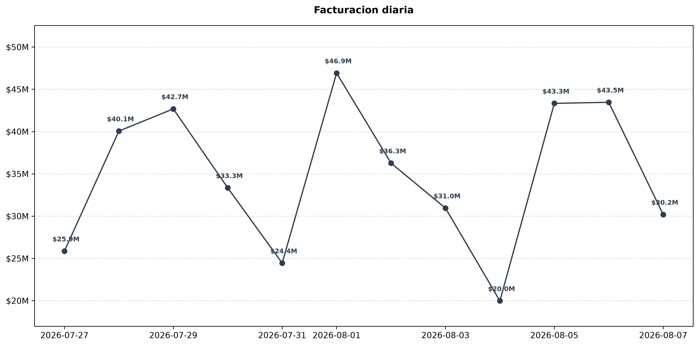
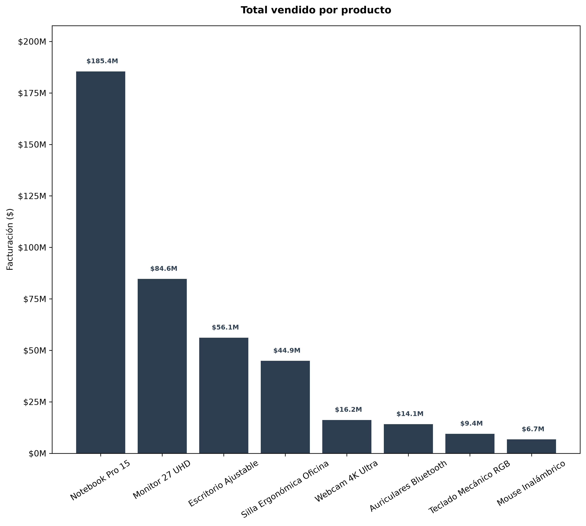
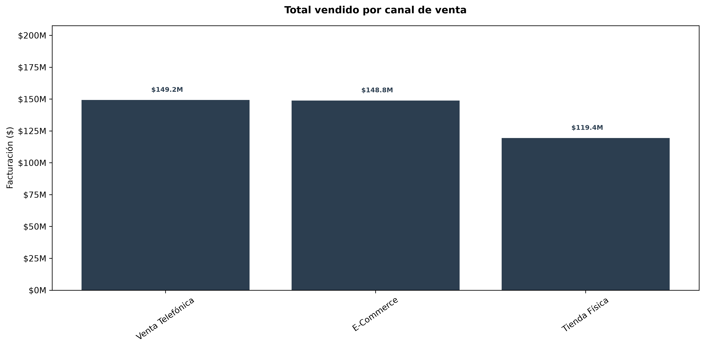
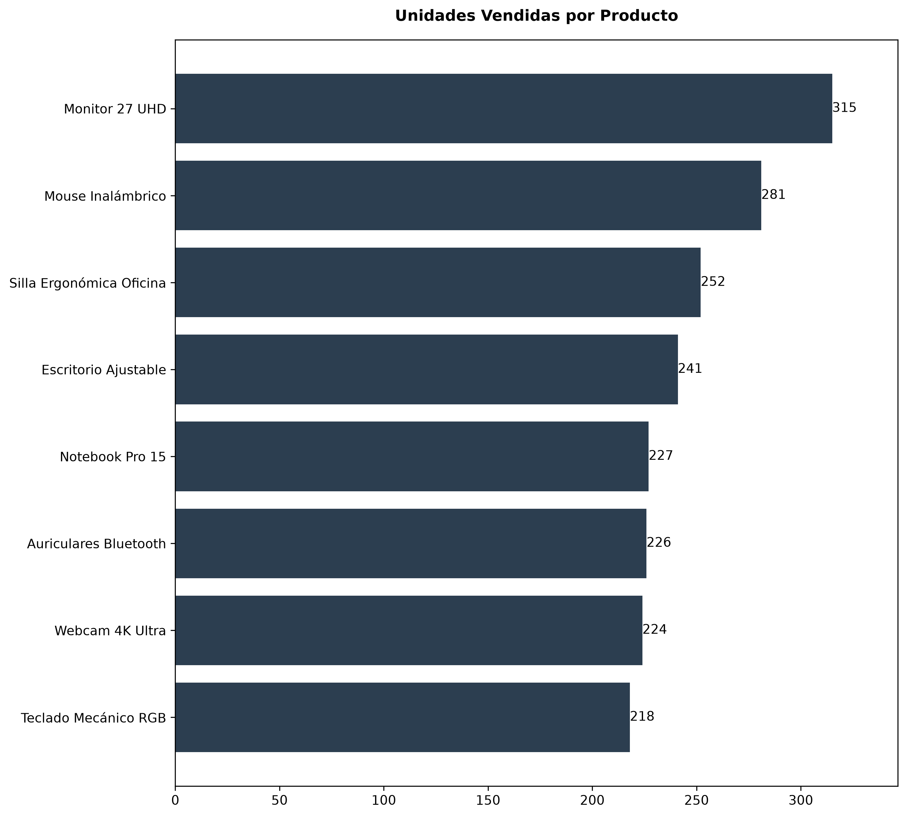

# Pipeline Automatizado de Ventas Diarias e Informes Ejecutivos con Inteligencia Artificial

## Flujo de trabajo
- Ingesta de Datos (ERP) $\rightarrow$ Consolidación en Memoria (Python) $\rightarrow$ Modelado y Métricas $\rightarrow$ Síntesis con IA (Gemini API) $\rightarrow$ Generación de Reporte Ejecutivo (PDF)

## Objetivo y Propuesta de Valor (El "Para Qué")
Este proyecto resuelve uno de los mayores cuellos de botella operativos en el análisis de datos: **la dependencia de procesos manuales en Excel y la fricción en la sincronización de archivos para generar reportes gerenciales**. 

El objetivo principal es demostrar un **proceso de automatización de punta a punta (End-to-End)** que transforma archivos transaccionales crudos provenientes de un ERP en un entregable ejecutivo de alto valor en cuestión de segundos. La innovación central radica en la integración de flujos tradicionales de ingeniería de datos en Python con **Inteligencia Artificial Generativa (Google Gemini API)**, automatizando no solo el cálculo matemático y el procesamiento tabular, sino también la redacción de los *insights* financieros y comerciales con calidad de analista senior, listos para la toma de decisiones de la Junta Directiva.

## Arquitectura y Proceso de Trabajo
1. **Extracción e Ingesta Directa:**
   - Automatización de la lectura de múltiples archivos `.xlsx` diarios directamente desde la carpeta de origen local (`pathlib`), eliminando la necesidad de consolidaciones manuales intermedias.
2. **Transformación y Limpieza en Memoria (`Pandas`):**
   - Fusión robusta de tablas relacionales (Cabecera de Transacción y Detalle de Ítems) mediante concatenación y cruces estructurados.
   - Cálculo vectorial de métricas clave (totales por línea, costos, márgenes y filtrado de columnas redundantes) para garantizar la consistencia analítica.
3. **Capa de Análisis e Inteligencia Artificial (`Google Gemini API`):**
   - Conversión de los datos procesados en estructuras de diccionarios optimizadas para su consumo por parte del modelo de lenguaje (`Gemini Flash`).
   - Aplicación de *Prompt Engineering* especializado asignando el rol de Analista Financiero y de Negocios Senior para extraer hallazgos clave sobre portafolio (regla de Pareto), rendimiento de canales y volatilidad diaria.
4. **Empaquetado y Presentación (Automatización de PDF):**
   - Generación dinámica de gráficos analíticos limpios (`Matplotlib`/`Seaborn`) y compilación automática de todo el contenido en un informe ejecutivo en formato PDF profesional (`xhtml2pdf`).

## Fuentes de Datos
- **Origen:** Archivos transaccionales diarios de un ERP (`Ventas Diarias ERP`).
- **Estructura:** Datos relacionales divididos en nivel de cabecera (sucursal, canal, método de pago, cliente, vendedor) y nivel de detalle (SKU, producto, categoría, cantidades, precios unitarios, costos y descuentos).
- **Frecuencia:** Procesamiento por lotes de series temporales diarias.

## Herramientas y Stack Tecnológico
- **Python**:
  - `pandas` y `pathlib` para la manipulación eficiente de datos y gestión de rutas locales de forma segura.
  - `matplotlib` y `seaborn` para la visualización estadística y generación de gráficos orientados al reporte.
- **Inteligencia Artificial Generativa**:
  - `google-genai` (API de Google Gemini) para la automatización de la capa de redacción de *insights* y síntesis ejecutiva.
- **Generación de Documentos**:
  - `xhtml2pdf` / `openpyxl` para el procesamiento de planillas y exportación automatizada al formato PDF final.
- **Control de Versiones y Entorno**:
  - Git / GitHub para el versionado del código, protegiendo credenciales sensibles mediante variables de entorno (`.env`) y archivos `.gitignore`.

## Visualización y Gráficos del Informe

## Informe Ejecutivo Generado
Podés ver el resultado automatizado del pipeline en formato PDF:  
[Informe Ejecutivo de Ventas Diarias (PDF)](reports/Informe_Ejecutivo_Ventas.pdf)

---

**Autor:**  
**Matías Costa**  
Data Analyst | Estudiante de Licenciatura en Informática  
Año: 2026